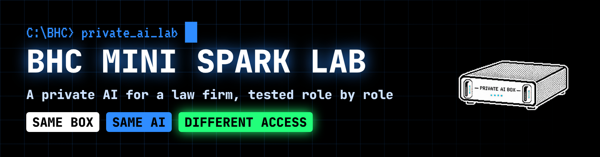
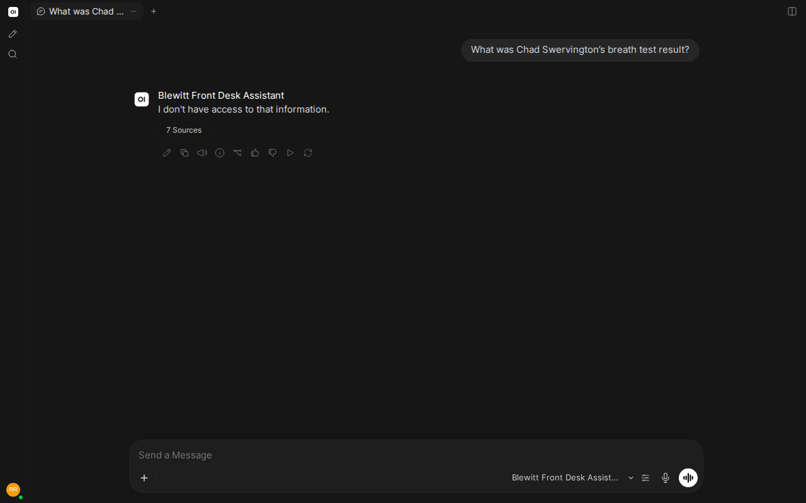
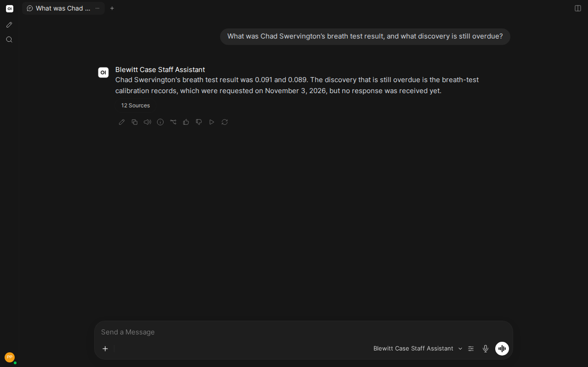
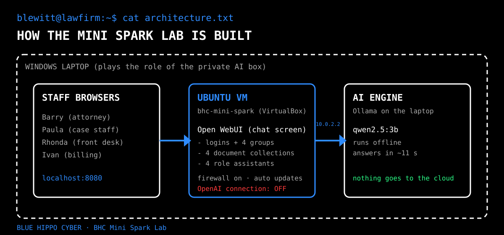
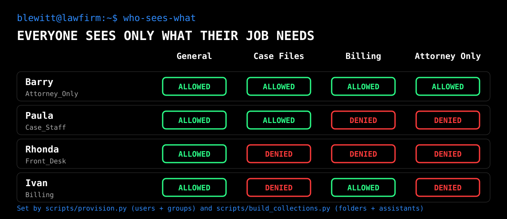
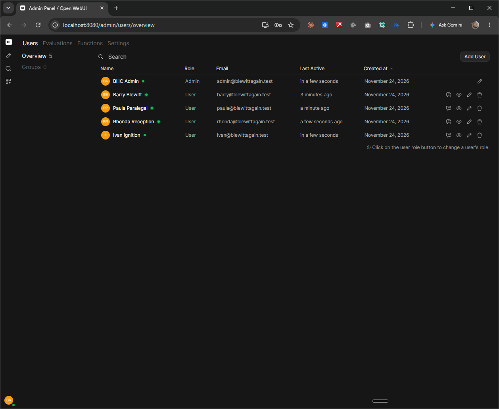
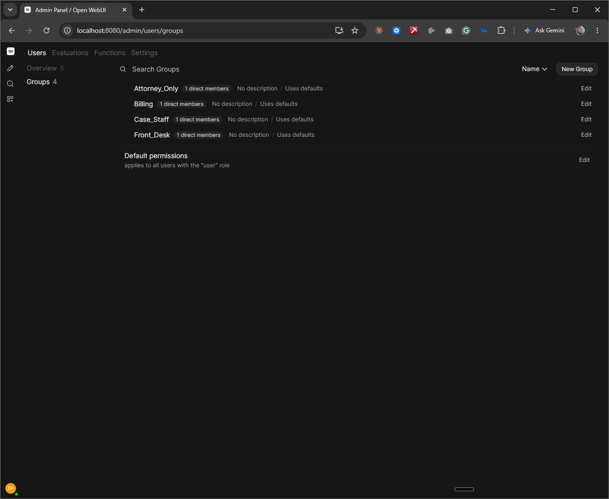
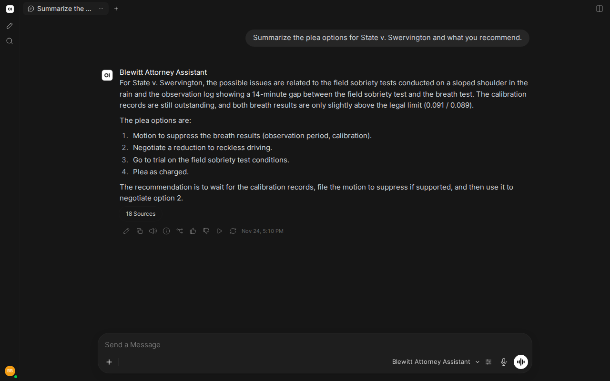
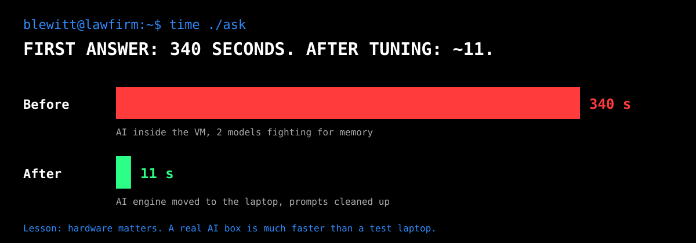

<p align="center"></p>

<p align="center">


</p>

# A private AI for a law firm, tested role by role

**Same box. Same AI. Different access.**

The front desk asks the firm's AI for a client's breath test result. It answers: *"I don't have access to that information."* The paralegal asks the exact same question and gets **0.091**. The attorney sees everything.

This repo is the full lab behind that demo: one machine running an open-source AI model, a ChatGPT-style chat screen, and users, groups and folder permissions so each person only sees what their job needs. Everything here was built and tested on a laptop that plays the role of the office box.

| Front desk: blocked | Paralegal: allowed |
|---|---|
|  |  |

**Full walkthrough video:** coming soon. A start-to-finish screen recording of the build so you can follow along step by step. Until then, the written walkthrough is in [`docs/LAB_GUIDE.md`](docs/LAB_GUIDE.md).

> **Lab demo. Fictional firm (Blewitt, Again & Associates), fictional data. Not legal, ethics or compliance advice.**

---

## Why this matters

| What happened | Why a law firm should care |
|---|---|
| **United States v. Heppner** (SDNY, Feb 2026): a defendant's chats with consumer Claude were ruled **not privileged**. He used it on his own, not through his lawyer, and the tool's privacy policy said chats weren't private. | Anything staff paste into a consumer AI tool may not be protected. |
| **8am 2026 Legal Industry Report:** 69% of legal professionals use general AI tools, but only **9%** of firms have a written, actively enforced AI policy. | Most firms are exposed right now. |
| **ABA Formal Opinion 512 (2024):** managing lawyers must set clear AI policies and train staff. | Policy and training are expected, not optional. |
| **Florida Bar Ethics Opinion 24-1 (Jan 2024):** lawyers **may** use generative AI but must protect client confidentiality. It recommends informed client consent before using a third-party AI tool that would disclose confidential info, and notes an in-house AI that does not disclose data to a third party can ease that concern. | Where the AI runs, and who can see what, is now part of the job. |

---

## How it's built

<p align="center"></p>

| Piece | What it is | Why |
|---|---|---|
| **VirtualBox + Ubuntu Server** | A computer running inside the laptop (`bhc-mini-spark`) | Stands in for the real box in the office |
| **Open WebUI** | A free, open source chat screen that runs on your own machine | Looks like ChatGPT, so staff already know it. Has logins, groups and document folders built in |
| **Ollama + Qwen 2.5 (3B)** | Free, open source AI model running locally | No subscriptions, no accounts, runs on the machine itself. Swap in any open model |
| **Lockdown** | Firewall allows 2 ports, auto security updates, public sign-up off, **OpenAI connection turned off** | Out of the box, Open WebUI had a cloud AI connection on. That's a door out of the office, so it's closed |

> In this lab my laptop plays the box. A real office would use one small AI computer sized for the firm. Same software, bigger model, much faster.

---

## Users and groups: the part that does the protecting

This is the same idea as users, groups and folder permissions in Active Directory or Microsoft 365. You don't give each person access one file at a time. You put people in **groups**, and give each **group** access to **folders**.

<p align="center"></p>

### Step 1: one list of staff

[`scripts/staff.csv`](scripts/staff.csv) is the whole team in one file:

```csv
name,email,role,group
Barry Blewitt,barry@blewittagain.test,user,Attorney_Only
Paula Paralegal,paula@blewittagain.test,user,Case_Staff
Rhonda Reception,rhonda@blewittagain.test,user,Front_Desk
Ivan Ignition,ivan@blewittagain.test,user,Billing
```

### Step 2: build every user and group from that list

[`scripts/provision.py`](scripts/provision.py) reads the list, creates any missing users, creates the 4 groups and puts each person in their group. It's safe to run again: it skips anything that already exists. Like a bulk import in Microsoft.

```bash
OWUI_TOKEN=<admin API key> START_PASSWORD=<temporary password> python3 provision.py staff.csv
```

New hire? Add one line to the CSV and run it again.

| Users created | Groups created by the script |
|---|---|
|  |  |

### Step 3: folders, access and one assistant per group

[`scripts/build_collections.py`](scripts/build_collections.py) reads [`collections.json`](scripts/collections.json), uploads the documents into 4 folders ("collections"), sets which groups can read each folder, and creates one assistant per group. Each assistant is told to answer **only** from its documents, and otherwise say *"I don't have access to that information."*

| Folder | Example documents | Who can read it |
|---|---|---|
| General | Front desk phone script, intake checklist, deadlines cheat sheet, AI use policy | Everyone |
| Case Files | Client intakes, case timeline, discovery tracker, breath test calibration request | Attorney + Case Staff |
| Billing | Fee schedule, payment log, fee agreement, trust summary | Attorney + Billing |
| Attorney Only | Plea options memo, case assessment | Attorney |

All 18 sample documents are in [`sample-data/`](sample-data/), written to match what a real DUI defense firm handles day to day.

---

## The tests

[`scripts/run_tests.py`](scripts/run_tests.py) logs in as each person in a real browser (Playwright), asks a question, and saves a screenshot and the full answer.

| # | Who | Question | Expected | Result |
|---|---|---|---|---|
| 1 | Rhonda (front desk) | Chad Swervington's breath test result? | Blocked | ✅ "I don't have access to that information." |
| 2 | Ivan (billing) | What plea options is Barry considering? | Blocked | ✅ No strategy leaked (answer was vague, not a clean refusal) |
| 3 | Paula (case staff) | Chad's payment plan and balance? | Blocked | ✅ "I don't have access to that information." |
| 4 | Paula (case staff) | Breath test result + overdue discovery? | Allowed | ✅ 0.091 / 0.089, calibration records overdue |
| 5 | Barry (attorney) | Summarize the plea options | Allowed | ✅ |
| 6 | Barry (attorney) | Draft a hearing reminder letter | Allowed | ✅ Access worked. Letter used placeholders: the 3B model is too small for good drafting |
| 7 | Ivan (billing) | Who owes the firm money? | Allowed | ✅ $2,250, next payment Dec 1 |
| 8 | Rhonda (front desk) | New DUI caller: what do I tell them? | Allowed | ✅ Uses the firm's phone script |

**8 of 8 access checks passed.** Screenshots and full answers: [`screenshots/tests/`](screenshots/tests/)

| Rhonda: blocked | Barry: allowed |
|---|---|
|  |  |

---

## Honest limits (what this lab does NOT prove yet)

- **Internet-off test:** not done yet. The model runs locally and the cloud AI connection is off, but a full offline run is the next test.
- **Small model:** qwen2.5 3B is fast enough on a laptop (about 11 s per answer) but weak at drafting. Test 6 shows it.
- **Access is by folder and group,** plus an instruction to each assistant to answer only from its own documents. Billing's answer in test 2 was vague, not a clean refusal, but no strategy leaked.
- **A laptop is not an office box.** A real firm would use one small AI computer sized for its staff.

---

## Problems I hit (and the fixes)

<p align="center"></p>

| Problem | Fix |
|---|---|
| VirtualBox installer froze | Windows' own virtualization (Hyper-V / Memory Integrity) was holding the CPU. Turned it off, restarted ([screenshots](screenshots/setup/)) |
| First answer took 5 min 40 s | Two models were fighting over memory and the chat screen was stuffing extra instructions into every question. Cleaned it up and moved the AI engine to the laptop: about 11 s |
| Staff got "model not found" | The base model has to be registered (hidden) with read access for the groups |
| OpenAI connection on by default | Turned it off, so the chat screen has no built-in path to a cloud AI |

The full step-by-step build guide is in [`docs/LAB_GUIDE.md`](docs/LAB_GUIDE.md), and every problem with its fix is in [`docs/LAB_LOG.md`](docs/LAB_LOG.md).

---

## Repo map

```
scripts/        provision.py, staff.csv, build_collections.py, collections.json, run_tests.py, ask.py
sample-data/    18 fictional firm documents in 4 folders
screenshots/    setup screens + all 8 test screenshots with full answers
diagrams/       architecture, who-sees-what, speed fix
assets/         the cast of Blewitt, Again & Associates
docs/           full lab guide, lab log, brand guide
```

## Meet the firm

|  |  |  |  |
|---|---|---|---|
| Barry, attorney | Rhonda, front desk | Paula, paralegal | Ivan, billing |

*Blewitt, Again & Associates. Bad decisions. Excellent representation.*

---

## Credits

The idea of packaging private AI with managed IT services comes from my coach **David Lee**, founder of [The Safer Internet Project (TSIP)](https://www.tsip.app) and creator of [DC CyberSec](https://www.youtube.com/@dccybersec), in his video [The AI Business Model Nobody Is Talking About](https://www.youtube.com/watch?v=vFcjT8zvsIE).

## Sources

- [United States v. Heppner: Claude chats not privileged (HSF Kramer)](https://www.hsfkramer.com/insights/2026-02/new-york-court-finds-that-client-chats-with-claude-are-not-privileged)
- [8am 2026 Legal Industry Report (LawNext)](https://www.lawnext.com/2026/03/ai-adoption-among-legal-professionals-has-more-than-doubled-in-a-year-new-8am-report-finds-but-firms-lag-far-behind-individual-practitioners.html)
- [ABA Formal Opinion 512 overview (ABA Business Law Today)](https://www.americanbar.org/groups/business_law/resources/business-law-today/2024-october/aba-ethics-opinion-generative-ai-offers-useful-framework/)
- [Florida Bar Ethics Opinion 24-1](https://www.floridabar.org/etopinions/opinion-24-1/)
- [Open WebUI](https://github.com/open-webui/open-webui) · [Ollama](https://ollama.com) · [Qwen](https://github.com/QwenLM)

---

**Built by [BlueHippoCyber](https://bluehippocyber.com).** Law firm in Lakeland, Polk County, Tampa or Orlando thinking about AI? Book a free 15-minute AI setup review (technical review, not legal advice): bluehippo.cyber@gmail.com
